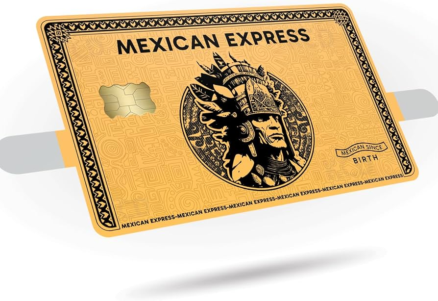

DIGITAL BANKING • PRODUCT STRATEGY • 2026

tanda.

**PRODUCT REQUIREMENTS DOCUMENT**

Final founder-approved product requirements \| Version 1.0 \| October 16, 2026 \| Implementation subject to partner and compliance validation

A culturally expressive, bilingual, digital-first financial platform designed for every generation.

Positioning: modern banking with the warmth of a community institution; rooted in Latino culture and accessible to customers of every background.

Founder interview: 8 of 8 rounds completed. Post-interview decision: full previously approved launch scope retained, even if delivery takes longer. Product, budget, and regulatory assumptions still require validation. Not a launch authorization or legal opinion.

| **Document status**                         | **Decision standard**                                                    |
|---------------------------------------------|--------------------------------------------------------------------------|
| **Founder scope approved; details pending** | All previously launch-approved functionality remains first-release scope |
| **Launch scope confirmed on Oct. 16, 2026** | Longer development timetable accepted; no automatic feature deferrals    |
| **Partner/compliance dependencies exist**   | Conditional = dependent on licensed provider, contracts, or law          |

## At a glance

- Launch geography: California and Texas; digital-only.

- Platforms: iOS, Android, and full web banking at public launch.

- Banking model: nonbank fintech working with an FDIC-insured partner bank.

- Launch policy: retain every previously approved launch feature in the first public release; extend timeline if necessary rather than silently deferring modules.

- Explicit exclusions: traditional rotating tandas and collaborative pooled savings.

# 1. Executive summary

TANDA is a concept for a U.S. consumer fintech platform. It combines everyday checking and savings with intuitive language-first service and culturally distinctive branding inspired by Mexican markets, panaderías, and neighborhood commerce. Latino identity informs the brand; product eligibility and customer experience are designed for all backgrounds and age groups.

The first public release is a comprehensive, partner-dependent launch: basic checking and savings; direct-deposit funding and defined external access; physical and virtual debit cards; individual savings automation; eligible TANDA-to-TANDA payments; English/Spanish service; TANDA Assist, TANDA Shield, Trusted Helper, ordinary joint accounts and Family tools; TANDA+ and Rewards. All are expected across iOS, Android, and full web banking. Live-money functionality requires bank and compliance sign-off.

# 2. Customer problem and differentiation

- Banking apps can be difficult to navigate, especially when essential functions are buried behind technical language or unfamiliar workflows.

- Customers need independent self-service, immediate explanations in their preferred language, and access to humans without embarrassment or unnecessary friction.

- Financially trustworthy experiences often look impersonal; culturally warm experiences can still be precise and regulated.

- TANDA differentiates on three equal pillars: simplicity/accessibility, competitive low-fee banking, and community-centered brand and service.

# 3. Product principles

- One excellent default UX: simple home screen first; optional user customization, not a separate “senior” interface.

- Bilingual by design: English/Spanish selection before enrollment; parity of essential functions and human support.

- Explain every financial action: available balance, fees, payment status, risk, and ownership are plainly communicated.

- Financial autonomy: trusted relatives can guide but never independently control funds or bypass owner verification.

- Mainstream product, visibly Latino brand: rooted in community culture but never ethnically exclusive.

- Compliance and account reconciliation precede speed, growth, or AI automation.

# 4. Core audience and use cases

| **Persona**                                 | **Primary jobs-to-be-done**                                                                    |
|---------------------------------------------|------------------------------------------------------------------------------------------------|
| **New-to-banking adult**                    | Open an account, receive wages, use debit card, understand balances and payments.              |
| **Working household**                       | Deposit wages/benefits, budget, save automatically, pay other TANDA users.                     |
| **Older / less digital-confident customer** | Use Spanish or English, ask aloud for help, navigate independently, recover access safely.     |
| **Family / trusted assistant**              | Guide another user through a task with permission; do not initiate or approve their transfers. |
| **Mainstream customer**                     | Use a reliable, low-fee bank-like digital experience without a culturally restrictive product. |

# 5. Decision record from 8 interview rounds

| **Round**                | **Founder-approved decisions**                                                                                                                                                                                                                                 |
|--------------------------|----------------------------------------------------------------------------------------------------------------------------------------------------------------------------------------------------------------------------------------------------------------|
| **1 / Vision**           | All generations equally; checking/savings/transfers; contemporary visual identity with prominent cultural expression; accessibility, value, and community equally central.                                                                                     |
| **2 / Initial products** | Basic checking; savings goals, automatic transfers and round-ups; TANDA-to-TANDA first; minimize customer fees.                                                                                                                                                |
| **3 / Experience**       | Language selection before sign-up; simple customizable home; 24/7 bilingual chat and business-hours phone; SSN/ITIN intent; Assist and Trusted Helper; physical + virtual cards.                                                                               |
| **4 / Brand**            | Expressively Mexican/Latino market-inspired aesthetic; six-color family; lowercase wordmark + symbol; adaptive voice; multiple culturally grounded card designs.                                                                                               |
| **5 / Trust**            | Plain-language bank disclosures; TANDA Shield; flexible sign-in; risk-based transfers; Family and later Family+; Emergency Lock.                                                                                                                               |
| **6 / Business**         | Diversified revenue + optional TANDA+ at \$7.99/month, waived at \$1,000 qualifying monthly direct deposits; local and national rewards; free basic rewards and premium boosts.                                                                                |
| **7 / Ecosystem**        | Future Global, Credit, Invest; independent release readiness; Mexico + selected Latin American remittance markets; credit-building then cards then lending; NO traditional tandas or pooled group savings.                                                     |
| **8 / Launch**           | California/Texas; FDIC-insured partner bank; iOS + Android + full web; multigenerational invite-only pilot; integrated marketing. Post-interview amendment: all previously approved launch features remain in first public release even if timeline increases. |

# 6. Initial public release scope and boundaries

Status legend: LAUNCH-COMMITTED means the founder requires a feature in the first public release, not that delivery is already feasible. CONDITIONAL means regulated partners, controls, vendors, funding, or legal sign-off are prerequisites. FUTURE means explicitly deferred products such as Family+ teen banking, Global, Credit and Invest. Do not de-scope launch features without new founder approval.

Founder decision (Oct. 16, 2026): option D overrides the earlier balanced MVP phasing decision. Launch date is flexible; essential features cannot be substituted with simulated financial services for public availability.

| **Capability**                                                  | **Proposed release**        | **Status / dependency**                                                             |
|-----------------------------------------------------------------|-----------------------------|-------------------------------------------------------------------------------------|
| **Checking, savings, approved deposits and account statements** | First public release        | LAUNCH-COMMITTED; partner bank, ledger and funding rails required                   |
| **Debit: mailed physical + in-app virtual card; card controls** | First public release        | LAUNCH-COMMITTED; issuer/network, fulfillment and security controls                 |
| **Savings goals, recurring transfers, debit round-ups**         | First public release        | LAUNCH-COMMITTED; debit card settlement, funding and savings rules                  |
| **TANDA-to-TANDA payments**                                     | First public release        | LAUNCH-COMMITTED; verified recipients, limits, risk and reversals policy            |
| **English + Spanish across iOS, Android, web**                  | First public release        | LAUNCH-COMMITTED; accurate translation and accessibility parity                     |
| **TANDA Assist (voice + typed, in-app help)**                   | First public release        | LAUNCH-COMMITTED; vetted voice/text help, safety evaluation and human handoff       |
| **TANDA Shield, risk checks, Emergency Lock**                   | First public release        | LAUNCH-COMMITTED; bank-approved fraud/hold controls and response staff              |
| **Trusted Helper and assisted recovery**                        | First public release        | LAUNCH-COMMITTED; permission design, verified recovery and abuse prevention         |
| **Ordinary joint accounts + Family household tools**            | First public release        | LAUNCH-COMMITTED; joint ownership policies, household privacy and bank approval     |
| **TANDA+, merchant rewards and waiver**                         | First public release        | LAUNCH-COMMITTED; \$7.99 / \$1k deposit waiver, merchants and viable unit economics |
| **SSN + ITIN opening**                                          | First public release target | CONDITIONAL; partner-bank CIP rules, documents and legal review                     |
| **24/7 bilingual human live chat; business-hours phone**        | First public release        | LAUNCH-COMMITTED; fund bilingual human service, fraud escalation and SLAs           |

# 7. Functional requirements — consumer banking

### **FR-01 Enrollment and account ownership \[LAUNCH / CONDITIONAL\]**

- Present language selection before registration and persist preferred language across channels.

- Support disclosure review, consent capture, identity verification, sanctions screening, and applicant status tracking through licensed partners.

- Plan SSN or ITIN applications where partner-bank customer identification policies and applicable requirements allow. Never promise approval.

- Make account ownership, funds availability, disclosures, and bank relationship easy to find.

### **FR-02 Checking, funding, and account ledger \[LAUNCH / CONDITIONAL\]**

- Provide available/current balance, transaction history, transaction status, account documents, and statements.

- Provide a defined account funding method at launch: direct deposit and external inbound/outbound bank transfer requirements must be confirmed. TANDA-to-TANDA alone cannot bring money into the system. Cash deposits remain partner-dependent rather than an unconditional launch guarantee.

- Define routing/account number access, inbound payroll/benefits support, holds, negative balances, dispute intake, and transfer limits with the partner bank.

- Keep internal account balances consistent with partner-bank ledger and daily reconciliation controls.

- Cash-deposit feasibility requirement \[CONDITIONAL\]: compare retail deposit networks and cash-accepting ATMs. Assess customer eligibility, statewide coverage, partner economics, fees, deposit availability/holds, regulatory controls, and alternatives for customers who rely on cash. Favor fee-free access when feasible; no method is committed until validated.

### **FR-03 Debit card and card servicing \[LAUNCH / CONDITIONAL\]**

- Issue a physical card automatically after eligibility and approval; make a corresponding virtual card accessible in the app.

- Provide card activation, lock/unlock, lost/stolen reporting, transaction push alerts, replacement handling, and supported digital wallets.

- Final network, card funding/authorization rules, shipment cost, and replacement-fee policy remain open.

### **FR-04 Savings \[LAUNCH / CONDITIONAL\]**

- Support an individual savings account with named goals, automatic transfers, and eligible debit-purchase round-ups.

- Provide balance/yield disclosures and make interest/APY contingent on the partner-bank product.

- No rotating tanda product, collective contribution pool, or non-joint shared savings goal is permitted.

### **FR-05 Domestic money movement \[LAUNCH / CONDITIONAL\]**

- Enable eligible TANDA-to-TANDA transfers with clear payee confirmation, limits, transaction status, and confirmations.

- Apply additional authentication/warnings or holds based on transaction risk and partner-approved policy.

- Clearly distinguish an internal TANDA-to-TANDA payment from an external ACH transfer, card purchase, or future cross-border payment.

# 8. Functional requirements — access, safety, and service

### **FR-06 TANDA Assist \[LAUNCH SIGNATURE\]**

- Persistent “?” help affordance in every major user journey; customers can type or use microphone input in English or Spanish.

- With consent, offer contextual explanations for the active screen and visual directions to the next action.

- AI is informational: it cannot silently initiate funds movement, approve payments, bypass authentication, or request passwords, PINs, or one-time codes.

- Offer agent handoff, accessibility alternatives, clear AI disclosure, sensitive-data minimization, and an audited knowledge base.

### **FR-07 TANDA Shield \[LAUNCH SIGNATURE\]**

- Use transaction and device risk signals to detect unusual activity and issue understandable scam/fraud warnings.

- Adapt challenge level and route high-risk cases to human review, subject to bank-approved legal and operational controls.

- Explain restrictions with an appeal/correction path; measure false positives as well as fraud reduction.

- Offer emergency access to card lock, session/device revocation, reporting unauthorized activity, and comprehensive Emergency Lock.

### **FR-08 Authentication and recovery \[LAUNCH\]**

- Offer strong login with supported password, passkey, and biometrics; enable appropriate step-up checks for sensitive events.

- Provide secure recovery for lost devices or forgotten passwords, including accessible guidance and human verification.

- Trusted Helpers can guide users through recovery but cannot reset credentials, see secrets, impersonate the owner, or approve sensitive activity; Trusted Helper is required for the initial public launch, subject to verified consent and abuse-prevention controls.

### **FR-09 Human support \[LAUNCH / CONDITIONAL\]**

- Plan live English/Spanish chat 24/7 and bilingual phone support during published business hours.

- Offer urgent fraud reporting and escalation whenever needed, including out-of-hours card and account protection.

- Define staffing, expected response times, privacy training, and complaint/dispute workflows before public launch.

### **FR-10 Family and trust features \[LAUNCH-COMMITTED / CONDITIONAL\]**

- Provide ordinary joint checking/savings where approved by the partner bank; accurately explain joint ownership and independent withdrawal authority. Joint account support belongs in the first public release.

- Deliver revocable Trusted Helper navigation and assisted recovery at first public launch; require granular consent, scoped access, audit logs, ability to revoke, and safeguards against coercion or financial exploitation.

- Family account permissions, budgets and joint ownership must be independently tested with bilingual users; the Trusted Helper feature cannot enable a third party to direct account activity.

- Deliver household budgeting views, subject to customer authorization and bank-partner support; do not create pooled group savings, shared savings circles, or non-joint collective contribution goals.

- Teen accounts and parental controls belong to a later Family+ phase, subject to product/legal validation.

# 9. Experience and visual identity

## 9.1 Home and navigation

- Default home shows available balances plus prominent Send Money, Add Money, and Savings shortcuts.

- Optional customization allows users to rearrange or hide dashboard sections; safe default navigation remains discoverable.

- Use readable type, contrast, spacious tap targets, keyboard/screen-reader support, explicit button labels, and consistent cross-platform terminology.

- Error messages must explain what happened, what customers can do, and how to request help.

## 9.2 Brand system

Reference atmosphere: Mexican supermercado, mercado, and panadería translated into a modern regulated financial product. Financial screens remain orderly and legible; expressive cultural identity is strongest in brand storytelling, campaigns, illustrations, and optional cards.

<table style="width:100%;">
<colgroup>
<col style="width: 16%" />
<col style="width: 16%" />
<col style="width: 16%" />
<col style="width: 16%" />
<col style="width: 16%" />
<col style="width: 16%" />
</colgroup>
<tbody>
<tr class="odd">
<td>Rojo TANDA 
#D63837</td>
<td>Amarillo Sol 
#F6B934</td>
<td>Verde Mercado 
#2D8050</td>
<td>Azul Cielo 
#2D60AC</td>
<td>Rosa Guayaba 
#EBA38D</td>
<td>Crema 
#F3E7CF</td>
</tr>
</tbody>
</table>

- Logo system: custom friendly lowercase “tanda.” wordmark plus a separately recognizable community-inspired symbol; combined and icon-only versions.

- Card system: standard solid-color cards, richly designed Mexican-cultural collections, and optional future premium/artist collaboration editions.

- When referencing specific craft traditions, collaborate with relevant artists and avoid generic or stereotyped motifs or unlicensed appropriation.

- Brand voice: expressive and optionally Spanglish in campaigns, plain and consistent in everyday service, patient in Assist, precise in fraud/security disclosures.

## 9.3 High-priority user journeys

1.  First use: choose Español/English → learn account terms → verify identity → view account/virtual card → fund account → receive physical card.

2.  Everyday send: select recipient → review verified identifier and amount → evaluate risk → confirm → show status and receipt.

3.  Need help: tap “?” → ask by voice or typing → contextual steps highlighted → complete action yourself or transfer to bilingual agent.

4.  Potential scam: unexpected risk warning → plain-language explanation → independent verification steps → additional authentication or pause → appeal/help.

5.  Device lost: use recovery path → identity verification → revoke device session → Emergency Lock if needed → restore access safely.

# 10. Commercial model and TANDA+

### **BM-01 Free core banking** *\[CONFIRMED GOAL\]*

- Aim for no monthly maintenance fees and minimal unavoidable charges; disclose any exceptions prominently and before customer action.

- Consider interchange, contracted partner revenue, and future regulated product revenues while avoiding misleading “totally free” claims.

### **BM-02 TANDA+ membership \[LAUNCH-COMMITTED / CONDITIONAL\]**

- Offer opt-in TANDA+ at \$7.99/month; waive the monthly membership fee when qualifying direct deposits total at least \$1,000 in the defined measurement period, subject to sustainable economics and clear enrollment/billing rules.

- Proposed qualifying sources include eligible payroll and benefit deposits; exact deposit codes, timing, grace periods, consent, and billing transitions remain open.

- First-release TANDA+ benefits should span supported financial perks, lifestyle/retail offers, and advanced analytics; specific cashback rates, yield differentials and merchant perks cannot be promised until contracted and economically validated.

- Essential support, security, disability accessibility, core banking, and fraud protections remain available without a premium subscription.

### **BM-03 TANDA Rewards \[LAUNCH-COMMITTED / CONDITIONAL\]**

- All users may access basic merchant offers and cashback opportunities; TANDA+ members may receive enhanced offers.

- Include both neighborhood Latino-owned businesses and national retail partners in voluntarily negotiated programs.

- Merchant-funded basic offers must be available to eligible free-tier users at first public launch; TANDA+ receives enhanced offers. Rates, eligibility, funding, disputes and eligible participating merchants require contracts and disclosures.

# 11. Platform, architecture, and operations

- Client applications: iOS, Android, and web share product rules and entitlement logic; support device-appropriate interactions and assistive technologies.

- Banking core: partner-bank deposit ledger plus compliant middleware/integration; no independent assertion that TANDA is a chartered bank.

- Payments: independent rails for direct deposit, ACH funding, P2P, debit card, and later remittances; each has different settlement, controls, and disclosures.

- Account service: reliable ledger reconciliation, operational dashboards, transfer exceptions, refunds/chargebacks, dispute queues, and customer notices.

- Security: encryption, secrets management, access controls, device/session audit, vulnerability management, business continuity, and incident response.

- AI: approved help content, contextual permission controls, evaluation in both languages, escalation paths, prompt-injection defenses, and no unauthorized transaction execution.

- Observability: operational alerts, account and payment status checks, privacy-aware event logs, and customer support troubleshooting tools.

- Accessibility: target WCAG 2.2 AA-aligned web practices and equivalent mobile accessibility testing; validate with target users.

# 12. Partner, legal, and consumer-protection gating

These are planning dependencies, not a determination that TANDA is regulated in any particular way. Qualified counsel, program management, and the partner bank must define allocations of responsibility before launch.

- Bank-partner contracts, deposit ownership records, accurate program disclosures and applicable FDIC/pass-through insurance representations.

- Identity verification/customer identification, sanctions screening, suspicious activity/AML controls, ITIN acceptance policies and escalation procedures.

- Electronic fund transfer error-resolution rights, unauthorized transfers, disclosure and customer communication requirements.

- Debit card network rules, disputes/chargebacks, merchant authorizations, card data handling, PCI-scope assessment.

- Privacy, third-party risk, complaint handling, accessibility, advertising claim substantiation, fair treatment, and retention requirements.

- For future Global: licensed remittance partners, corridor availability, required exchange-rate/fee disclosures, cancellation, errors, delivery estimates and local payout compliance.

- For future Credit and Invest: appropriate licensed lenders/broker-dealers, fair-lending and securities compliance, separate risks/disclosures and supervision.

# 13. Go-to-market and release roadmap

| **Stage**                               | **Scope**                                                                                                                                                                                                        | **Exit criteria**                                                                                                                                         |
|-----------------------------------------|------------------------------------------------------------------------------------------------------------------------------------------------------------------------------------------------------------------|-----------------------------------------------------------------------------------------------------------------------------------------------------------|
| **0. Design + feasibility**             | Clickable prototype, partner search, service blueprints, bilingual usability research.                                                                                                                           | Bank partner path, funding rails mapped, high-risk assumptions reviewed.                                                                                  |
| **1. Internal alpha**                   | Simulated account flows, Assist, Shield, test card/transfer lifecycle; platform and security QA.                                                                                                                 | Critical defects resolved; bank signoffs for beta plan.                                                                                                   |
| **2. Invite-only CA/TX pilot**          | Multigenerational cohort, both languages, realistic usability tasks; limited live money only after required approvals.                                                                                           | Task success, reconciliation, fraud and support performance acceptable.                                                                                   |
| **3. Complete public launch**           | Checking/savings, funded accounts, cards, TANDA payments, savings tools, bilingual support, Assist, Shield, Trusted Helper, eligible joint accounts and Family budgeting, TANDA+ and Rewards on iOS/Android/web. | Every launch-committed capability passes legal, bank, security, accessibility, operational and quality gates; allow additional time and budget if needed. |
| **4. Post-launch refinement + Family+** | Optimize the live product and partner offers; later add teen banking/parental controls and other features never approved for first release.                                                                      | Measured stability, customer needs, approvals, and independent economic case.                                                                             |
| **5. New regulated product lines**      | Global to Mexico + selected LatAm; Credit building → secured cards → unsecured cards → loans; Invest and retirement via licensed partners.                                                                       | Launch independently when compliant and validated.                                                                                                        |

TANDA Invest is an approved long-term product category, but specific investment instruments, brokerage partner, retirement product sequencing, and target market need a later detailed PRD.

# 14. Marketing and distribution

- Initial launch states: California and Texas; digital-first without physical branches.

- Integrated campaigns: TikTok, Instagram, YouTube, bilingual radio/media, select billboards/transit, influencer and referral programs.

- Community programs: merchant partnerships, local cultural events, on-the-ground customer education and inclusive research.

- Long term: consider physical financial support spaces in major Latino/Hispanic communities (for example San Diego or Los Angeles) only if justified by customer demand and economics.

- Every campaign must explain that TANDA is a fintech and accurately identify the insured bank providing deposit services.

# 15. Quality standards and success measures

| **Area**                | **Proposed metric / release test**                                                                                                                                  |
|-------------------------|---------------------------------------------------------------------------------------------------------------------------------------------------------------------|
| **Onboarding**          | Completion, abandonment, document-verification exception rate; measured by language and age-group research cohorts without using age as discriminatory eligibility. |
| **Usability**           | Independent task completion: balance check, card lock, transfer, savings goal, Assist voice use; study diverse ages and languages.                                  |
| **Banking reliability** | Daily partner ledger reconciliation; successful posting, dispute/error handling, balance correctness, uptime/incident response.                                     |
| **TANDA Shield**        | Detected fraud, loss rate, true/false positive rate, high-risk payment challenge outcomes, customer appeal handling.                                                |
| **TANDA Assist**        | Safe resolution rate, hallucination/incorrect-step rate, bilingual quality, human handoff success, accessibility usability.                                         |
| **Economics**           | Unit contribution margin, card shipment cost, support cost per account, rewards cost, TANDA+ qualification and churn.                                               |
| **Growth**              | Activated accounts, first funded account, funded account retention, customer referrals, community partner activations.                                              |

Launch metrics and numeric acceptance thresholds remain to be signed off, but approved first-public-release modules may not be dropped solely to meet an arbitrary date. A realistic budget, complete compliance readiness, independent usability evidence, and operational support are release gates.

# 16. Contradictions, superseded decisions, and open issues

## 16.1 Superseded — already resolved

- Rotating tanda circles originally scheduled for Phase 2 were explicitly canceled due to safety concerns; the name remains cultural inspiration only.

- Shared savings circles/group pools and non-joint collaborative goals were explicitly canceled. Individual savings goals and ordinary joint accounts remain possible.

## 16.2 Founder decision — launch scope conflict resolved

- Resolved October 16, 2026: founder selected option D, retaining all previously approved launch features in the first public release, including Trusted Helper, eligible joint accounts and Family budgeting, TANDA+ and basic/enhanced Rewards. The earlier “balanced MVP with other features phased in” wording is superseded.

- Delivery implication: extend the timetable and funding plan rather than moving approved launch modules to a post-launch release. If a bank partner, compliance control, accessibility standard or vendor requirement is unmet, launch must wait or scope must be explicitly re-approved by the founder.

- Open operational decision: “TANDA-to-TANDA first” limits initial consumer P2P sending, not all banking rails. Funded accounts still require direct deposit and appropriate external funding/withdrawal processes. Cash-deposit approach is partner-dependent (founder decision: option D); ACH capability and ATM access still need definition and partner approval.

- Open feasibility risk: 24/7 bilingual human chat, business-hours bilingual phone, simultaneous iOS/Android/web, Trusted Helper oversight, TANDA+ fulfillment and card shipping substantially increase time-to-launch, staffing and fixed costs.

- Open economic risk: no-monthly-fee core banking, mailed cards, potential cashback, \$7.99 fee waiver and 24/7 support must be validated as a single sustainable unit-economics model before public launch.

## 16.3 Additional open specifications

- Define detailed acceptance criteria, staffing and vendor owners for each launch-committed feature; scope is approved, implementation specifications are not yet complete.

- Select partner bank, middleware, debit network, ACH/P2P rails, fraud vendors, reconciliation owner, and complaints owner.

- Specify the basic checking offering: overdraft policy, deposit/withdrawal limits, early direct deposit, and direct deposit eligibility. Approved ATM policy: free in-network withdrawals for all customers; out-of-network fees may apply and must be disclosed. Evaluate retail cash-deposit partners and deposit-enabled ATM networks separately.

- Specify savings APY/yield policy, round-up transfer timing, and savings account type and customer disclosures.

- Define \$1,000 monthly deposit calculation, qualification period, grace period, failed payroll cases, subscription opt-in, and premium downgrade behavior.

- Confirm ITIN onboarding eligibility and acceptable documents by partner and jurisdiction.

- Define Trusted Helper consent, visibility levels, fraud/abuse controls, recovery and revocation procedures.

- Select the first Global destination corridors and payout methods, and separate Global from domestic product scope.

- Finalize primary logo, card designs, font licenses, accessible color pairings, production translations, brand name/trademark clearance, and domain strategy.

- Fund and staff the proposed support, security, fraud, compliance and customer-success operations; define business hours and coverage SLAs.

- Approve testing sample size, acceptance thresholds, launch gating and financial model assumptions.

# 17. Proposed founder sign-off order — remaining open decisions

> 1\. Confirm remaining account funding and cash-access details. Approved: Plaid-assisted external bank linking, free standard ACH transfers, optional fee-based instant transfers where supported, and free in-network ATM withdrawals. Retail/ATM cash deposits remain partner-dependent.
>
> 2\. Second: validate a funded delivery plan for the complete first-release scope: partner bank, transfer rails, card issuer, support staffing, bilingual AI, trusted-helper controls, Family, TANDA+ and Rewards.
>
> 3\. Third: resolve subscription fee-waiver mechanics, savings APY, settlement and overdraft policies, economic assumptions, customer protections, and formal release criteria.
>
> 4\. Fourth: obtain partner and legal approvals, conduct independent testing and CA/TX multigenerational pilot, and authorize launch only once all required modules satisfy signed-off acceptance gates.

# Appendix — planning references

These are public reference points for counsel/product planning, not definitive legal advice:

- FDIC — Banking With Third-Party Apps: https://www.fdic.gov/consumer-resource-center/2024-06/banking-third-party-apps

- CFPB — Electronic Fund Transfers (Regulation E): https://www.consumerfinance.gov/rules-policy/regulations/1005/

- CFPB — EFT Error Resolution FAQs: https://www.consumerfinance.gov/compliance/compliance-resources/deposit-accounts-resources/electronic-fund-transfers/electronic-fund-transfers-faqs/

- CFPB — Remittance Disclosures: https://www.consumerfinance.gov/rules-policy/regulations/1005/31/

# Founder decision addendum — Account access and money movement

## 9.2 External account linking and transfers

APPROVED: Use Plaid to connect and verify eligible external bank accounts, with consent, account disconnection controls, bilingual guidance, and fallback methods for unsupported institutions. ACH execution and settlement are provided through approved banking/payment partners.

APPROVED: Standard ACH transfers are free to customers. Optional instant transfers may carry a clearly disclosed fee, with speed, eligibility, limits, and estimated delivery shown before confirmation.

## 9.3 ATM withdrawal policy — latest founder decision

APPROVED (Option A, superseding earlier Option C): All eligible TANDA customers receive free withdrawals at participating in-network ATMs. Out-of-network fees may apply and must be clearly disclosed. No TANDA+ ATM reimbursement benefit is committed for launch. Network partner, locator, withdrawal limits, and surcharge treatment remain to be specified.

NOTE: Physical cash deposit functionality is a separate partner-dependent feasibility decision, not implied by free ATM withdrawals.

## 9.5 Overdraft protection — founder-approved

DECISION: Option D. Launch both (1) limited fee-free overdraft coverage for eligible checking customers, and (2) optional savings-backed overdraft protection. This is a product requirement, subject to partner-bank approval and regulatory review.

TANDA Spot: eligible customers may overdraw up to \$50 without overdraft fees or interest, subject to an individually approved limit no greater than \$50. Clearly disclose eligibility, covered transaction types, limits, repayment mechanics, and circumstances in which payments may be declined.

Savings Backup: with affirmative customer authorization, transfer available funds from the customer’s own eligible TANDA savings account to cover qualifying checking shortfalls. No savings-backup transfer fee. Allow customers to manage or revoke authorization; do not imply transfers can exceed available savings funds.

UX and safeguards: bilingual notices, low-balance alerts, straightforward settings, transaction history, and accessible explanations. Customers choose the order of Savings Backup and TANDA Spot after receiving an explained recommendation. Partner-bank review must define operational restrictions and disclosures.

IMPLEMENTATION DEPENDENCIES: eligibility criteria, approved recommended default, qualifying transactions, repayment timing, customer consent, regulatory review, and partner-bank approval. Founder decisions on coverage cap and customer-selectable priority are closed.

# Founder decisions — Overdraft priority and TANDA Spot limits

## 9.6 Smart overdraft protection priority

APPROVED (Option D): TANDA recommends a protection order between optional Savings Backup and eligible fee-free TANDA Spot coverage, but the customer may override the recommendation and change the order in settings. The recommendation must be explained in plain English and Spanish. Savings transfers require authorization; settings cannot be silently changed. The recommended default remains an open design decision.

## 9.7 TANDA Spot coverage limit

APPROVED (Option A): TANDA Spot provides up to \$50 in fee-free overdraft coverage for eligible customers at launch. No overdraft fee or interest is charged on covered amounts. Display approved and remaining limits, clear repayment information, and eligible transaction types. Eligibility criteria, repayment procedures, consumer consent, regulatory requirements and banking-partner approval are launch gates; coverage is not guaranteed for all customers.

Supersession: personalized limits above \$50, and proposed \$100/\$200 launch coverage are not approved. The founder-selected launch cap is \$50.

# Founder interview closure and release dependencies

FOUNDER INTERVIEW: COMPLETE. No further founder questions are required for this PRD. The final approved TANDA Spot launch maximum is \$50; both fee-free eligible overdraft coverage and optional savings-backed transfers remain in scope, with customer-selectable priority after a clear recommendation.

UNRESOLVED IMPLEMENTATION DEPENDENCIES (not new founder decisions): FDIC-insured partner-bank contract and program approvals; identity/CIP/ITIN eligibility; Plaid and ACH/instant transfer integration; ATM network and surcharge terms; cash deposit feasibility; TANDA Spot underwriting, consent and repayment rules; joint account and Trusted Helper controls; savings yield and direct-deposit qualification; TANDA+ rewards economics; security, fraud, bilingual support, legal disclosures and testing thresholds.

Release gate: retain founder-approved launch scope unless the founder explicitly authorizes a change. Any feature blocked by legal, technical or partner feasibility must be flagged as a launch blocker or escalated for a scope decision, not silently marked as delivered.

Appendix — Founder-Approved Visual Aesthetic References

These six founder-supplied references are the aesthetic direction for TANDA. They are moodboard references only, not cleared artwork for reproduction or commercial use. TANDA should commission original artwork and license any third-party designs where necessary.

## Expressive Mexican art

Rich painterly Mexican visual storytelling, layered foliage, vivid warm tones, and cultural artistry. Use as an inspiration for editorial storytelling, not as a literal banking UI background.

## Colorful calaveras

Saturated hand-painted folk-art palettes and varied decorative characters. Use selectively for seasonal campaigns and licensed artist collaborations.

## Symmetrical floral motifs

Bold, flat-color floral symmetry, vines, petals, and botanical ornament. Develop an original scalable TANDA pattern library.

## Tile and papel picado graphics

High-contrast, modular color-blocked flowers, birds, and geometric tiles suitable for social graphics, illustrations, and cards.

## Dark-ground folk floral art

Elegant bright floral symmetry on black, useful for premium card concepts and special collections.

## Ornamental gold card concept

A decorative premium payment-card direction: detailed border, warm gold palette, strong focal medallion. Create original imagery and avoid copying existing card brands or culturally sensitive iconography.

## Brand application rules

Use the founder’s vivid Mexican folk-art inspiration across debit-card collections, marketing, illustrations, motion, and branded touchpoints. Keep transactional screens legible, accessible, secure, and uncluttered. Maintain clear contrast, recognizable controls, and bilingual usability. Avoid using sacred or culturally specific imagery without appropriate research, consultation, and artist involvement.
